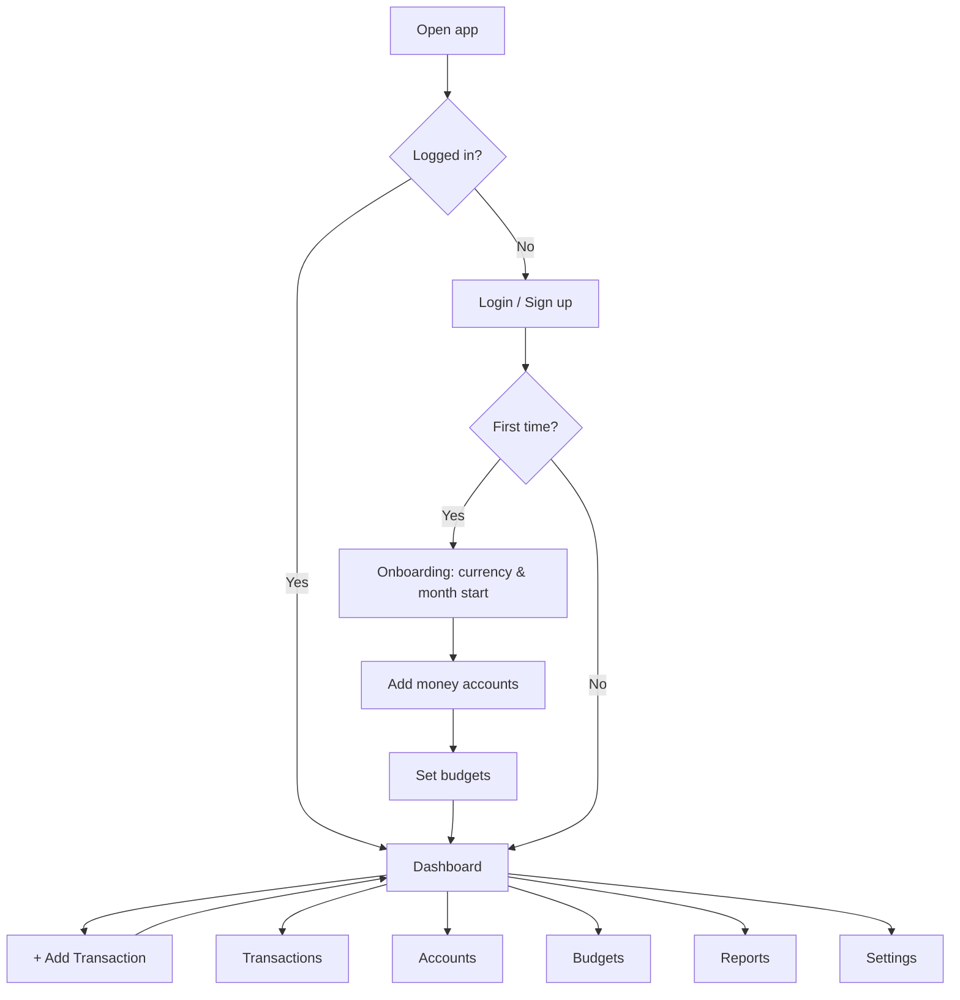
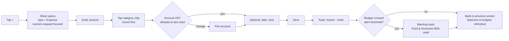
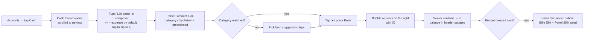
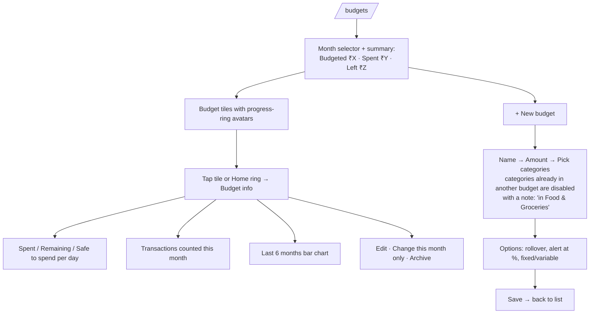
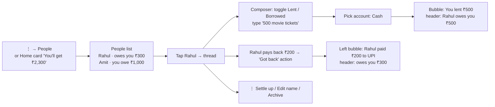

# App Flow

**Product:** HisaabChat (personal expense tracker)
**Date:** 2026-10-08 (revised: WhatsApp-inspired UI · Flutter for Android, Windows, Web)
**Related:** [PRD](01-PRD.md) · [UI/UX Design Brief](04-UI-UX-Design-Brief.md)

---

## 1. Sitemap

The paths below are **go_router** routes. On Web they're also the browser URLs.

```
Public
├── /              Splash: checks the stored token → /dashboard, /onboarding or /welcome
├── /welcome       Welcome screen (Get started / I already have an account)
├── /login
├── /signup
└── /forgot-password

Onboarding (first login only)
└── /onboarding    Step 1 Month start → Step 2 Accounts → Step 3 Budgets → Done

App (authenticated)
├── /dashboard                     Home: balance card, Due soon, budget rings row, You'll get / You owe, recent
├── /search                        Search everything (🔍, the rail's 🔍, Ctrl+F)
├── /transactions                  Chat-list style list + search pill + filter chips
│   (the full transaction form is not a route: full-screen page on phones, dialog on wider windows)
├── /accounts                      Accounts as a "chats" list + net worth
│   ├── /accounts/[id]             Account THREAD: transactions as bubbles + quick-add composer
│   └── /accounts/[id]/info        Account info (contact-info style)
├── /budgets                       Budgets list with progress-ring avatars
│   └── /budgets/[id]              Budget info: ring, stats, categories, history, actions, then its expenses (paged)
├── /people                        Lend & borrow (v1.0): people list with balances (⋮ menu on phones, rail on desktop)
│   └── /people/[id]                Person THREAD: lent/borrowed/repaid bubbles + composer
├── /reports                       Category breakdown, 6-month trend (⋮ menu on phones)
│   └── /reports/category/[id]     That category's transactions for the period (paged)
└── /settings
    ├── /settings/profile          Name, time zone, month start
    ├── /settings/appearance       Theme, accent color, reduce motion
    ├── /settings/categories       Manage categories (with search)
    ├── /settings/recurring        Recurring rules
    ├── /settings/connection       Server status
    └── /settings/data             Export / delete account (Phase 7, not built yet)
```

**Primary navigation**: WhatsApp-style, chosen by window width, so it applies to Android, Windows and Web alike.
- **Compact (< 600 dp, phones), like WhatsApp Android:** app bar with the app name in the accent color, 🔍 (opens Search everything) and ⋮. Bottom `NavigationBar` with **Home · Transactions · Budgets · Accounts**. An accent-colored **FAB** at the bottom-right adds what the section is about (transaction, budget, account, person). The **⋮ menu** holds **People, Reports and Settings** (Categories and Recurring are inside Settings); those open full screen with a back arrow, and People keeps its + button.
- **Medium (600–839 dp):** 64 dp icon rail + one full-width pane. Threads and info pages push over the list.
- **Expanded (≥ 840 dp, Windows/desktop web), like WhatsApp Desktop:** icon rail (the + and 🔍 at the top, then Home, Transactions, Budgets, Accounts, People, Reports; Settings and the profile avatar at the bottom; the rail scrolls in short windows) + **list panel** + **detail pane** (account or person thread, budget info, transaction form). The detail pane shows a placeholder until something is selected.
- The full transaction form opens as a **full-screen page** (compact) or a **dialog** (wider); editing from the desktop Transactions list opens it in the detail pane.
- **Keyboard (Windows/Web):** Ctrl+1…6 switch sections, Ctrl+F search everything, Esc back/close, Enter send. *Planned: Ctrl+N new transaction, ↑/↓ in lists, Del delete.*
- **Back (every platform):** closes whatever is on top first (form, sheet, dialog, menu, chat, Settings page). On any section other than Home it goes to Home; only Back on Home leaves the app (Android). Triggers: Android Back, the browser's Back (open forms and dialogs have their own history entry, so the page underneath doesn't change), Esc, and the mouse back button. Esc never closes the app.

## 2. Overall Flow



## 3. Flow Details

### 3.1 Sign up & Onboarding
1. **Sign up**: name, email, password → account created → default categories seeded → access token stored securely on the device.
2. **Onboarding step 1, Your month**: month start day (default 1st, e.g. the 25th if that's payday); the time zone detected at sign-up is shown. Currency is ₹ INR for now. *Skip setup* is available on every step.
3. **Onboarding step 2, Accounts**:
   - Suggestions: **Cash** (ticked), **Bank** and **UPI**. Tick the ones you have and enter what each holds now.
   - If you already have accounts, this step just lists them.
   - Nothing is forced: skipping leaves you with no accounts, and Home invites you to add the first one.
4. **Onboarding step 3, Budgets**:
   - Suggested budget cards: **Room Rent**, **Food & Groceries**, **Bike EMI + Petrol**, **Education**. Each is pre-linked to its categories (e.g. Bike EMI + Petrol → *Bike EMI*, *Petrol*, *Bike Maintenance*).
   - The user ticks the ones they want and enters a monthly amount for each; a ticked one without an amount can't be finished.
   - Templates whose categories are already used by a budget are hidden.
5. **Done** → Home with a tip: "Open an account and type an amount to log your first expense."

### 3.2 Add Expense (the most frequent flow, optimized for speed)

- **Validation**: amount > 0; category required; account required.
- **Overspend**: if the expense makes a non-credit account negative, show a soft warning ("Cash will go to −₹50. Save anyway?"). It isn't blocked.
- **Save & add another**: a secondary button keeps the sheet open with the same account and date.
- **Windows/Web:** the same form as a dialog or slide-in. Ctrl+N opens it, Tab moves through fields, Enter saves, Esc closes.

### 3.2a Quick-add from an account thread (WhatsApp-style, fastest path)

- Saves to **the account whose thread is open**, dated **now**.
- 📎 opens the full form prefilled with what was typed (to change the date, set Repeat, or make it a Transfer).
- If saving fails: the bubble shows ⚠ "Not saved · Tap to retry", and the input is never lost.

### 3.3 Add Income
Same sheet with the **Income** tab selected. The category list shows income categories (Salary, Freelance…). On save, the account balance increases. Budgets aren't affected.

### 3.4 Transfer between accounts
1. **+** → **Transfer** tab.
2. Amount → **From** account → **To** account (the same account can't be picked twice) → date → note (e.g. "ATM withdrawal").
3. Save → From balance decreases, To balance increases. Not counted in income/expense totals or budgets.
4. A credit card bill payment is modeled as Transfer: Bank → Credit Card.

### 3.5 Edit / Delete Transaction
1. Tap a transaction tile or bubble → the full form opens in **edit mode** with values filled in.
2. Change any field (including type, account or amount) → Save → balances are recalculated (old effect reversed, new effect applied).
3. **Delete** → confirm dialog → deleted → toast with **Undo** (5 s).
4. **Long-press** a tile or bubble → WhatsApp-style selection mode (the app bar shows the count, 🗑 delete, ⧉ duplicate). Tap more items to select several.
5. *Planned (Phase 7):* swipe left on a tile to delete (Android); hover chevron or right-click menu and the Del key (Windows/Web).

### 3.6 Transactions List
- Chat-list style tiles (category avatar · category · `Account · note` · amount + time), grouped under small headers like `TODAY · −₹540`. Newest first, **paged as you scroll** (40 at a time). A day header shows its total only once that whole day has loaded, never a partial sum.
- Top: **search pill** (matches the note, category, account, person, or an amount like `120`), then **filter chips**: All · Expense · Income · Transfer, then a **Money in / Money out / Net** summary for everything that matches (from the server, not just the loaded page).
- *Planned:* a month picker chip and **More filters** (accounts, categories, date range, amount range).
- Empty state: "No transactions this month. Tap + to add one."

### 3.7 Accounts
1. `/accounts`: **Net worth** card, then one **chat-style tile per account**: avatar, name, last transaction as the preview line, balance + last activity time on the right. Sorted by recent activity; long-press → 📌 Pin to keep one on top. Credit cards show "Outstanding ₹X".
2. **＋ (FAB / panel header) → New account** form: name, type, opening balance, color/icon, include in total (toggle), credit limit (credit cards only).
3. Tap an account → **Account thread**: money out on the right, money in on the left, transfers shown on both accounts' threads, adjustments as centered system chips, and the quick-add composer at the bottom (see 3.2a).
4. Tap the thread header → **Account info**: balance, month in/out, Edit, **Reconcile balance** ("What's the actual balance?" → creates an adjustment), Export, then **Archive** / **Delete** (only if no transactions) in red.

### 3.8 Budgets

- **Unbudgeted spending**: a card at the bottom shows "Other spending (not in any budget): ₹X" so nothing is hidden.
- **Status colors**: the ring and % pill are green (< alert %), amber (≥ alert %) or red (> 100%), always paired with text ("Over by ₹350").
- **Home** shows the same rings as a horizontal row (like WhatsApp's status row). Tapping one opens that budget's info.

### 3.9 Recurring Transactions
1. Create from the Add Transaction sheet ("Repeat: Monthly on day 5") or from **Settings → Recurring → + New**.
2. Each rule: template (type, amount, account, category, note), frequency, start date, end date (optional), **auto-add** or **remind me**.
3. Home shows a **"Due soon"** section with a count badge: reminders waiting for you, what repeats in the next 7 days ("Bike EMI · In 3 days · Adds itself"), and lend/borrow due dates ("Amit to pay you back · Due in 2 days", for the amount still owed).
4. On the due date (the server catches up whenever the app is opened, plus an hourly `recurring:run`):
   - Auto-add → the transaction is created and appears with a 🔁 badge.
   - Remind → a tile in Due soon with **Confirm** (a dialog to keep or change the amount, then it's added) or **Skip**.
5. **Settings → Recurring** lists every rule ("Monthly on the 5th · Auto-add · Cash", next date). Tap to edit; Pause/Resume and Delete are in the form (or long-press). Deleting keeps the transactions it already added.

### 3.10 Reports
- Month switcher, then chips **Spending** | **Income**: donut chart by category + ranked list (category, share bar, amount, %).
- Tap a category → that category's transactions for the month, paged, with the full count and total at the top.
- **Money in vs out · last 6 months**: grouped bars (two columns on desktop).
- *Planned (Phase 7):* **Export CSV** (web download, Windows Save As, Android share sheet) and a 12-month trend.

### 3.11 Settings (WhatsApp-style: profile header + icon rows)
- **Profile header**: initials avatar, name, email → tap to edit name.
- **Account**: name, time zone, month start day.
- **Categories**: Expense / Income tabs, search, list with color and icon; add, edit, archive. *Drag to reorder: planned.*
- **Recurring**: rules list (edit, pause, delete).
- **Appearance**: theme (System/Light/Dark), **color** (10 accents, Teal by default, saved to the account), Reduce motion. *Planned: thread wallpaper, font size.*
- **Connection**: whether the app can reach the server and database.
- *Planned (Phase 7)* **Data**: export all (CSV/JSON), delete account (type "DELETE" to confirm).
- **Log out** / **Log out of all devices**.

### 3.12 Lend & Borrow with People (v1.0)

- The composer has four chips, **Lent · Borrowed · Got back · Paid back**, the account it comes from or goes into, and (for Lent/Borrowed) an optional **due date**.
- **Settle up** records all or part of what's owed into or out of one account; archiving needs a settled balance.
- *Planned (Phase 7):* **Forgive / write off** a balance nobody will pay back.
- **Lend** = money out of your account (right bubble); **Borrow** = money in (left bubble). **Collect** and **Repay** settle the balance partly or fully.
- These entries update account balances but never appear in income/expense totals or budgets.
- A due date adds an item to Home → Due soon ("Pay back Amit · Due Friday") until it's paid back.

### 3.13 Search
- **Search everything** (🔍 in the phone's app bar, the 🔍 in the desktop rail, or Ctrl+F) opens a full-screen search with the field focused.
- Results, grouped: **Accounts**, **People**, **Budgets** (matched by name; budgets also by their categories, so "petrol" finds *Bike EMI + Petrol*) and **Transactions** (note, category, account, person, or an amount like `120`, `1,250.50`, `₹450`), with the total number of matching transactions; more load as you scroll.
- Tapping a result opens it; Back returns to the results with the search still typed.
- Lists also have their own search box: Transactions, Accounts, People, Budgets and Settings → Categories. Every search box has a ✕ to clear it.

## 4. Key States & Edge Cases

| Situation | Behavior |
|---|---|
| No accounts yet | Add Transaction is disabled, with the prompt "Add an account first" |
| Composer text has no number | ➤ stays disabled; hint "Start with an amount, e.g. 120 tea" |
| Composer words match no category | Suggestion chips show recent categories; one must be picked before sending |
| Save fails from the composer | Bubble shows ⚠ "Not saved · Tap to retry"; nothing is lost |
| Category archived | Hidden from pickers; past transactions still show it (greyed) |
| Account archived | Hidden from pickers and totals (optional toggle); history kept |
| Category moved between budgets | Past months recalculate against the current mapping (documented behavior) |
| Transaction dated in a past month | Past month's budget spend updates |
| Budget with no categories | Not allowed. At least one category is required |
| Edit changes Expense → Transfer | Category is cleared, "To account" is required; balances are fully re-applied |
| Network error on save | Sheet stays open with entered data and a retry button |
| Token expired or revoked (401) | Clear the stored token, redirect to login, then return to the original page |
| No internet connection | "Waiting for network…" banner; forms keep entered data; composer bubbles stay 🕒 and retry |
| Window resized (Windows/Web) | Layout switches live between compact, medium and expanded without losing state |
| Same data edited on two devices | Last write wins; lists refresh on screen focus and on pull-to-refresh |
